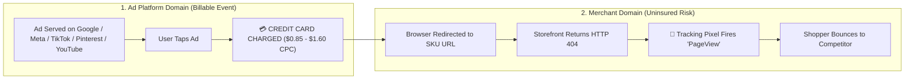
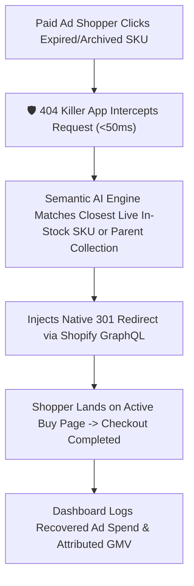

# 📘 The CFO Capital Protection Playbook
### Eliminating the "404 Ad Tax," Insulating Blended MER, and Recovering Lost EBITDA
**Prepared by:** 404 Killer App / DevRevIQ LLC  
**Executive Contact:** Dale Johnson, Founder & CEO | `(435) 962-4444` | `djohnson@404killer.com`  
**Portal:** [https://404killer.com](https://404killer.com) &nbsp;|&nbsp; **Agency & Enterprise:** [https://404killer.com/agencies](https://404killer.com/agencies)

---

## Executive Preface: Speaking the Language of Finance

When engineering and marketing teams discuss "broken links" or "404 errors," finance executives naturally tune out—assuming it is a minor IT housekeeping issue.

**It is not an IT issue. It is an unmonitored, continuous cash leak on the P&L.**

In modern direct-to-consumer (DTC) and omnichannel retail, customer acquisition cost (CAC) and paid media represent **20% to 38% of gross revenue**. Every time an out-of-stock SKU is archived, a seasonal collection handle is altered, or an influencer's affiliate link ages out, paid traffic continues driving capital into dead endpoints.

In financial terms, **a 404 error on a paid click is 100% Working Capital Incineration**:
1. **SG&A / Marketing OpEx is debited immediately** by Meta, Google, or TikTok.
2. **Gross Margin realized is $0.00**, because dead pages have a 0.0% conversion rate.
3. **Blended CAC is artificially inflated**, forcing surviving product pages to subsidize the dead clicks.
4. **EBITDA is directly reduced dollar-for-dollar** by the wasted ad spend, plus the forfeited contribution margin of the lost sale.

This playbook provides the complete financial, contractual, and operational advocacy for why subscribing to **404 Killer App** is one of the highest-ROI capital allocation decisions a retail CFO can authorize.

---

## Pillar 1: Why Google, Meta & Amazon Will Never Refund Your "404 Ad Tax"

A common misconception among financial controllers is: *"If our landing page throws an error, surely Google or Meta doesn't bill us for that click, or our tracking pixel prevents it."*

**Both assumptions are false.** Here is the contractual and technical reality of digital ad billing:

### 1. Billing Occurs on Departure, Not Arrival
Under the Master Services Terms of Google Ads, Meta Business, TikTok, Pinterest, YouTube, and Amazon DSP, the billable event is an **Outbound Click Redirect**. The microsecond a consumer taps your ad, the auction clears and your corporate credit card is billed. The ad network's contractual duty ends the moment the user's browser requests your domain.

### 2. Why Tracking Pixels Make It Worse (False Telemetry)
Tracking pixels (Meta Pixel, Google Tag Manager, Pinterest Tag, Attentive, TikTok Pixel) are embedded in the global `<head>` of your storefront theme. When a shopper hits a `404 Not Found` page, your server still renders an HTML error template—which executes those global scripts.
* The ad platform receives a `200 OK` telemetry ping from the pixel saying *"The user viewed a page!"*
* Even if your engineering team suppresses the pixel on 404 pages, **you are still billed 100% of the click cost**, because billing is triggered at the ad server, not by the destination pixel.

### 3. The 72-Hour Crawler Lag & Zero-Refund Policy
Google Ads (`Googlebot-Ads`) and Google Merchant Center run automated crawlers that eventually disapprove ads pointing to dead URLs ("Destination Not Working"). **However:**
* Ad crawlers operate on **periodic 24- to 72-hour batch intervals**—not real time.
* When your inventory system archives a fast-selling variant on Tuesday morning, your live Meta Advantage+ and Google PMax campaigns continue pumping high-CPM traffic into that dead URL until Friday.
* **Zero Retroactive Credits:** Ad platforms never issue refunds for traffic delivered prior to crawler disapproval.

### 4. The "Immortal Pin & Evergreen Video" Trap (Pinterest & YouTube)
While an Instagram Story vanishes in 24 hours and a TikTok post decays in 48 hours, **Pinterest Promoted/Shopping Pins and YouTube Video Descriptions/Shopping Feeds have an evergreen half-life of 6 to 24+ months**.
* High-intent shoppers click viral Pinterest pins and YouTube review/haul descriptions a full year after a seasonal SKU or colorway was archived.
* Because Pinterest and YouTube traffic compounds over time, unhealed catalog routes create an **ever-growing multi-year 404 tax** on your highest-intent visual search and video traffic.

### 5. The Structural Conflict of Interest ($Billions in Platform Margin)
Dead-link ad clicks account for an estimated **1.2% to 3.0% of all e-commerce ad spend globally**. For Google, Meta, and Pinterest, that represents billions of dollars in pure, high-margin auction revenue. Furthermore, under the **"Airline vs. Hotel" Liability Doctrine**, ad networks will never insure internal merchant inventory changes due to advertiser fraud and moral hazard risks.

> [!IMPORTANT]
> **The CFO Takeaway:** No external ad vendor will ever protect your capital once the click leaves their platform. **Capital protection must sit at your storefront's edge.**

---

## Pillar 2: The Organizational Governance Gap (RACI Failure)

Why haven't your internal teams or retained agencies solved this already? Because broken catalog routing sits in the cracks between three siloed departments—a phenomenon known as **"The Triangle of Blame."**

### The Enterprise E-Commerce RACI Matrix

| Executive / Department | RACI Role | Primary KPI | Why the Leak Persists Without Automation |
| :--- | :--- | :--- | :--- |
| **CFO / VP of Finance** | **Informed (I)** | **EBITDA, Free Cash Flow & Blended MER** | Sees rising CAC and compressing MER on monthly financials, but lacks URL-level forensic visibility into *why* ad efficiency is dropping. |
| **CMO / VP of Growth** | **Accountable (A)** | **Top-Line GMV, Blended ROAS, CAC** | Owns the marketing budget, but has zero operational control over daily inventory deletions or theme route changes. |
| **VP of Paid Media / Ad Agency** | **Responsible (R)** | **In-Platform ROAS & CPA** | Optimizes bids and creative, but isn't notified when internal merchandisers unpublish sold-out variants. |
| **Merchandising / Inventory Ops** | **Trigger (Culprit)** | **Sell-Through Rate & Catalog Hygiene** | Archives out-of-stock SKUs and renames seasonal collections to keep the site clean, unaware that live ads point to those URLs. |
| **Web Engineering / IT** | **Consulted (C)** | **Site Uptime & Core Web Vitals** | Cannot manually author hundreds of 301 redirects per week in Shopify Admin in real time. |

### The Flaw of Manual Labor Arbitrage
Relying on humans to fix 404s is a losing financial proposition:
1. **Detection Lag:** A human only notices a broken link in Google Analytics *days or weeks* after thousands of ad dollars have already been incinerated.
2. **Payroll Waste:** Paying an $85,000/yr e-commerce coordinator or a $175/hr agency developer to manually look up broken URLs and type 301 redirects into Shopify Admin is high-cost, reactive labor.

---

## Pillar 3: Forensic Unit Economics & Storefront Benchmarks

Live diagnostic crawls across global Shopify Plus storefronts (including **Fashion Nova** at ~24.5M monthly visits and **Gymshark** at ~11.8M monthly visits) demonstrate that even elite 9-figure brands suffer from persistent 0.8% to 1.5% catalog route decay due to rapid SKU turnover and limited-edition drops.

### Annual Capital Leakage Benchmarks by Brand Size

| Storefront Tier (Annual GMV) | Est. Annual Ad Budget | Conservative 404 Hit Rate | Annual Burned Ad Cash (Direct Loss) | Forfeited Contribution Margin (Lost Sales) | Total Annual EBITDA Drag |
| :--- | :--- | :--- | :--- | :--- | :--- |
| **Emerging DTC ($5M GMV)** | $1,200,000 / yr | 1.2% | **$14,400 / yr** | **$28,800 / yr** | **-$43,200 / yr** |
| **Growth Brand ($25M GMV)** | $6,000,000 / yr | 1.2% | **$72,000 / yr** | **$144,000 / yr** | **-$216,000 / yr** |
| **Mid-Market ($50M GMV)** | $12,000,000 / yr | 1.1% | **$132,000 / yr** | **$264,000 / yr** | **-$396,000 / yr** |
| **Enterprise ($150M+ GMV)** | $35,000,000 / yr | 1.0% | **$350,000 / yr** | **$700,000 / yr** | **-$1,050,000 / yr** |

---

## Pillar 4: How 404 Killer App Works (Autonomous Capital Insurance)

**404 Killer App (Revenue Shield)** acts as an automated financial firewall between your paid media traffic and your ever-changing product catalog.

### Core Financial & Operational Capabilities:
1. **Sub-50ms Autonomous Edge Healing:** Intercepts broken product, variant, and collection URLs instantaneously and routes the shopper to the highest-converting live alternative or parent category.
2. **Paid Ad Spend Guard (`utm_`, `fbclid`, `gclid`, `ttclid`, `epik`):** Prioritizes traffic carrying paid advertising tokens (Meta, Google, TikTok, Pinterest, and YouTube) to ensure your media agency's blended ROAS and MER never dip from inventory churn.
3. **Real-Time CFO & CMO Attribution Ledger:** Tracks exact click volume intercepted, ad spend preserved, and incremental revenue recovered.

---

## Pillar 5: Financial ROI, Risk Diligence & Subscription Economics

When evaluating software subscriptions, disciplined CFOs apply four tests: **Cost, Payback Period, Technical Risk, and Return on Invested Capital (ROIC).**

### 1. Subscription Tiers vs. Value Recovered

| Plan Tier | Ideal Store Profile | Monthly OpEx | Annual OpEx (Save 10%+) | Breakeven Threshold |
| :--- | :--- | :--- | :--- | :--- |
| **Starter Shield** | Emerging Stores (<$2M GMV) | **$29 / mo** | **$290 / yr** | Saving just **1 order per month** pays for the entire year. |
| **Growth Shield** | Scaling DTC Brands ($2M–$25M GMV) | **$79 / mo** | **$790 / yr** | Saving **12 ad clicks per week** yields 100% breakeven. |
| **Enterprise / Agency** | Shopify Plus & Multi-Store ($25M+ GMV) | **$149 / mo** | **$1,599 / yr** | **<48-Hour Payback Period** (often 100x–400x annual ROIC). |

### 2. Enterprise Security & Risk Diligence Checklist

* **Zero PII / Zero GDPR & CCPA Liability:** 404 Killer App inspects URL path strings and HTTP status codes only. It never touches, stores, or processes customer names, emails, payment methods, or personal data.
* **Zero Page-Speed Degradation:** Operates via native Shopify Admin GraphQL 301 routing at the server/edge level (<50ms). Zero bulky client-side JavaScript bloat.
* **Zero CapEx / Zero Implementation Cost:** 2-minute installation via official Shopify App architecture. Requires zero engineering sprints or developer retainers.
* **Zero Lock-In Risk:** All created 301 redirects are written natively into your Shopify store's routing table.

---

## Pillar 6: Internal CFO Subscription Approval Memo (Copy & Send)

*For CMOs, Heads of E-Commerce, or Agency Partners requesting immediate sign-off from Finance:*

> **MEMORANDUM: High-ROI OpEx Authorization Request**  
> **To:** Chief Financial Officer / VP of Finance  
> **From:** Marketing & E-Commerce Operations  
> **Subject:** Eliminating Paid Ad Spend Bleed on Archived Catalog Routes ($149/mo OpEx for Est. $5,000+/mo EBITDA Recovery)
> 
> **1. Problem Identified:**  
> When our merchandising team archives out-of-stock SKUs or updates seasonal collections, our active Meta, Google PMax, TikTok, Pinterest Promoted Pins, and YouTube Shopping/Creator links continue driving paid clicks ($0.85–$1.40 CPC) into HTTP 404 dead ends. Because ad networks bill on click departure and evergreen links on Pinterest and YouTube live for 12–24+ months, we are absorbing a 1.0%–1.5% dead-click tax on our ad budget with 0% conversion return.
> 
> **2. Proposed Remediation:**  
> Deploy **404 Killer App (Revenue Shield)** ([https://404killer.com](https://404killer.com)), an autonomous Shopify edge utility that intercepts dead catalog links in <50ms and dynamically routes paid shoppers to live in-stock alternatives via native Shopify GraphQL.
> 
> **3. Financial Economics & Risk:**  
> - **Software OpEx:** $149/month ($1,599/year) — Instant Enterprise & Agency Production Activation.  
> - **Implementation Cost:** $0 (2-minute plug-and-play setup, zero developer hours).  
> - **Compliance & Security:** Zero customer PII ingested; zero storefront latency impact.  
> - **Expected Payback Period:** < 48 hours of preserved ad traffic.  
> - **Estimated Annual EBITDA Preservation:** $45,000 – $120,000+ in recovered ad spend and retained GMV.
> 
> **4. Action Requested:**  
> Approval to activate the annual subscription at **[https://404killer.com](https://404killer.com)** (or **[https://404killer.com/agencies](https://404killer.com/agencies)** for multi-store portfolio coverage).

---

*© 2026 DevRevIQ LLC / 404 Killer App. All Rights Reserved.*  
*8770 E Via De Viva, Scottsdale, AZ 85258 | `(435) 962-4444` | `djohnson@404killer.com`*
